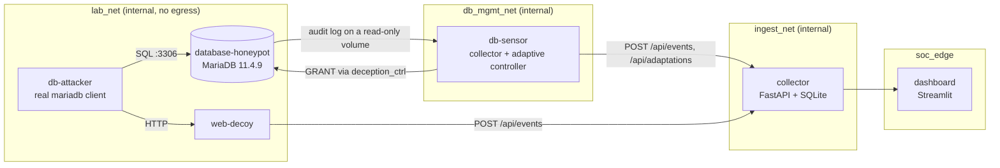

# Database Honeypot: TransNova Logistics

A real MariaDB server filled with fictional logistics data. An attacker connects with an ordinary
MySQL client and runs genuine SQL. Every statement is captured from the server's own audit log,
classified, scored and sent to the SOC. When the attacker's behaviour matches a rule, a controller
grants access to hidden decoy tables, and the attacker's next query proves the deception worked.

**One-line pitch:** the database watches what you look for, then shows you something more tempting.

All data is synthetic. Nothing connects to a production system.

---

## 1. Architecture



The proof chain, using real data at every step:

```text
attacker SQL -> MariaDB executes or denies it -> audit log line -> sensor parses and classifies
  -> POST /api/events -> alert -> rule matches -> real GRANT -> attacker's next query succeeds
  -> that query is captured the same way -> dashboard links trigger -> change -> follow-up
```

The attacker never writes to the SOC. The SOC only learns what the database itself recorded.

## 2. Folder map

| Path | Purpose |
|---|---|
| `Dockerfile`, `conf/honeypot.cnf` | MariaDB image, logging and containment settings |
| `initdb/01_schema.sql` | 31 tables: 23 visible, 8 adaptive |
| `initdb/02_seed.sql` | Generated synthetic data (committed, reproducible) |
| `initdb/accounts.sql.tmpl`, `03_accounts.sh` | `decoy_user` and `deception_ctrl` setup |
| `seed/generate_seed.py` | Regenerates the seed deterministically |
| `sensor/db_sensor/` | The Python sensor (see section 7) |
| `sensor/config/rules.json` | All scores, thresholds, MITRE mappings and adaptive rules |
| `scripts/native_lab.py`, `start_native_stack.ps1` | Run everything without Docker |
| `scripts/run_live_tests.ps1`, `demo_attack.sql` | Live test runner, scripted attack |
| `tests/` | Unit tests; `tests/live/` drives a real client against a real server |

Outside this folder: `collector/`, `dashboard/`, `docker-compose.yml`, `.env.example`.

## 3. Database schema

Database name: `transnova_logistics`.

| Group | Tables | Rows (seed 20261031) |
|---|---|---|
| Customers and shipments | `customers`, `delivery_addresses`, `shipments`, `shipment_items`, `tracking_events`, `invoices`, `payments` | 150 customers, 380 shipments, 986 items, 2060 tracking events, 380 invoices, 196 payments |
| Logistics operations | `employees`, `delivery_agents`, `vehicles`, `warehouses`, `inventory`, `routes`, `dispatch_records`, `maintenance_records` | 45 employees, 23 agents, 15 vehicles, 8 warehouses |
| Business | `shipping_partners`, `support_tickets`, `api_integrations` | 8 partners, 90 tickets, 16 integrations |
| Sensitive-looking decoys | `api_credentials`, `admin_accounts`, `warehouse_access`, `partner_contracts`, `internal_network_assets` | Visible from the start |
| Adaptive decoys | `shipment_archive`, `premium_customer_records`, `backup_credentials`, `warehouse_security_logs`, `internal_transfer_records`, `executive_shipments`, `restricted_routes`, `disaster_recovery_backup` | Hidden until revealed |

Key relationships: a customer has many shipments and addresses; a shipment has many items and
tracking events, and belongs to a route, agent and warehouse; invoices relate customers to
shipments; payments relate to invoices; API integrations and credentials chain back to shipping
partners. Foreign keys are enforced, and a live test checks every one for orphans.

Fake secrets are marked by construction: `tnk_TEST_...` keys, `TEST-only-...` secrets, `.example`
domains, and internal IPs from the reserved 198.18.0.0/15 benchmarking range.

## 4. Accounts

| Account | Can connect from | Rights |
|---|---|---|
| `decoy_user` | anywhere in the lab | `SELECT` on 23 named tables. Limited to 10 connections and 5 s per statement |
| `deception_ctrl` | only the sensor's address | `SELECT ... WITH GRANT OPTION` on the 8 adaptive tables, plus read access to `mysql.tables_priv` |
| `root` | local socket | Used only by first-boot scripts |

`decoy_user` has no CREATE, DROP, ALTER, INSERT, UPDATE, DELETE, GRANT OPTION, SUPER or FILE. Grants
are per table on purpose: a database-level grant would also cover the hidden tables.

`deception_ctrl` cannot read `api_credentials`, drop anything, create users, or grant anything other
than those 8 tables. A live test tries each of these and confirms the refusal.

## 5. What MariaDB actually hides (tested)

| Attacker action before reveal | Real result on 11.4.9 |
|---|---|
| `SHOW TABLES` | 23 tables; no adaptive table listed |
| `information_schema.tables` / `.columns` | 23 tables; 0 rows for a hidden table |
| `SELECT * FROM backup_credentials` | `ERROR 1142` |
| `SELECT * FROM table_that_does_not_exist` | The same `ERROR 1142` |
| `DESCRIBE` / `SHOW CREATE TABLE` on a hidden table | `ERROR 1142` |

So the tables are not discoverable through metadata, and a denial does not confirm that a table
exists. Table-level grants take effect on the attacker's next statement, with no reconnect.

## 6. Log capture: what each log really gives

| Capability | Audit plugin (`server_audit.log`) | General log | Error log |
|---|---|---|---|
| Every SQL statement | Yes | Yes | No |
| Client IP on each line | Yes | Only on the connect line | Failed logins only |
| Server return code | **Yes** | No | No |
| Failed logins | Yes (`FAILED_CONNECT`, 1045) | Yes | Yes, at `log_warnings=4` |
| Tables the server really opened | **Yes** (`READ` lines) | No | No |
| Client source port | No | No | No |
| Rows returned | No | No | No |

The audit plugin is the sensor's only parsed source, because the return code is what separates an
attempt from a success. `READ` lines name each table the server opened, and they are merged into
the classification: `EXECUTE IMMEDIATE CONCAT('SELECT * FROM api_', 'credentials')` hides the table
from its own text, and only the server knows what it read. The general and error logs stay on the volume as raw evidence to show
judges. HANDOFF_FINAL.md asked us to prove native audit capture before relying on it: the
plugin ships in the official packages and was verified on 11.4.9.

```text
20261031 14:54:45,dbhost,decoy_user,127.0.0.2,7,143,QUERY,transnova_logistics,'CREATE TABLE unauthorized_test (id INT)',1142
                                                                                                           server said no ^
```

## 7. Sensor pipeline

| File | Job |
|---|---|
| `tailer.py` | Follows the log across appends, partial lines, restarts and rotation |
| `audit.py` | Parses lines; `LineAssembler` rejoins records split by injected newlines |
| `classify.py` | sqlglot tokenizer and parser, with a token fallback when parsing fails |
| `risk.py` | Explainable scoring and evidence-based ATT&CK mapping |
| `events.py` | Builds canonical events; separates internal traffic; rejects unbound lines |
| `adaptive.py` | Rules, GRANTs, before and after verification, audit records |
| `emitter.py` | JSONL log, batched POST, spool and replay |
| `state.py` | SQLite state: log position, per-source behaviour, sessions, reveals |
| `reset.py` | Revokes reveals between demo runs |

Delivery follows the web decoy's contract: JSON arrays of at most 50 events, a spool on failure,
exponential backoff, and deduplication at the collector on `event_id`. IDs are derived from the log
line, so re-reading a line after a crash cannot create a second event.

**Internal traffic:** statements are excluded only when username AND client host both match
`INTERNAL_ACCOUNTS`. A login as `deception_ctrl` from anywhere else is reported as attacker activity,
`decoy_user` is reported even on the local socket, and a failed login is never excluded. The raw log still keeps the
controller's statements. This is what stops the SOC's own queries creating alerts.

## 8. Event format

The sensor emits the canonical envelope from HANDOFF_FINAL.md §6. That schema forbids extra
fields, so data it has no field for goes into `raw_evidence_redacted`, in the same `detections[]`
shape the web decoy uses.

| Requested field | Where it lives |
|---|---|
| `event_id`, `timestamp`, `source_ip`, `username`, `session_id`, `query_type`, `database_name`, `action` | Same name in the envelope |
| `source`, `honeypot_type` | `service: database`, `sensor_id: db-01`, and in evidence |
| `query` | `command` (redacted, bounded to 2048 characters; the full text stays in the log) |
| `target_table` | `table_names[]`, and `target_table` in evidence |
| `source_port` | Always `null`: MariaDB's audit log does not record it |
| `destination_ip`, `destination_port` | Evidence |
| `classification`, `severity`, `risk_score`, `attack_stage`, `risk_reasons`, `mitre` | Evidence |
| `raw_event` | Evidence (redacted, bounded). The unmodified line stays in the log volume |
| `metadata` | Evidence: `server_retcode`, `server_error`, audit ids |

Adaptation records are a separate model on a separate endpoint (`POST /api/adaptations`), because
they record what we changed. They are never counted as attacker activity.

## 9. Classification, risk and ATT&CK

Score = category base + behaviour modifiers, capped at 100. Every point appears in `risk_reasons`,
and all values are editable in `sensor/config/rules.json`.

| Band | Score | Typical example |
|---|---|---|
| LOW | 0 to 24 | `SELECT * FROM shipments LIMIT 10` (12), `SHOW TABLES` (10) |
| MEDIUM | 25 to 49 | Repeated enumeration (25), denied read of a hidden table (40) |
| HIGH | 50 to 74 | Sensitive table read (50), denied schema change (50), denied GRANT (60) |
| CRITICAL | 75 and up | Sensitive read after enumeration across several sensitive tables, or an adaptive decoy read |

An ordinary `SELECT` cannot reach CRITICAL, however often it runs. A test checks this.

`outcome` comes from the server: `succeeded` (0), `blocked` (a permission error), `failed` (syntax
and similar). A denied `UPDATE` is `modification_attempt` + `blocked`, never a successful change.

| Technique | Mapped when | Not mapped when |
|---|---|---|
| T1552 Unsecured Credentials | `api_credentials` or `backup_credentials` is read | A plain SELECT elsewhere |
| T1087 Account Discovery | `admin_accounts`, `mysql.user` or `information_schema.user_privileges` is targeted | `SHOW GRANTS` on one's own account |
| T1213 Data from Information Repositories | Business-sensitive decoys are read, or 5+ distinct tables | A single routine SELECT |
| T1110.001 / .003 | 5+ failed logins in 60 s from a source (.003 with 4+ usernames) | One failed login |

A denied statement is mapped as `attempted` with low confidence, because nothing was collected.
Denied writes get no technique at all. A SELECT is not called exfiltration: the sensor cannot see
what left the server, only what was asked for.

## 10. Adaptive deception

Rules count successful reads per (username, source IP), and are deterministic.

| Rule | Stage | Trigger | Reveals |
|---|---|---|---|
| `A-SHIPMENT-EXPLORATION` | 1 | 3+ reads across 2+ of shipments, items, tracking, customers, addresses | `shipment_archive`, `premium_customer_records` |
| `B-CREDENTIAL-EXPLORATION` | 1 | 2+ reads of api_integrations, api_credentials, admin_accounts | `backup_credentials` |
| `C-INFRASTRUCTURE-EXPLORATION` | 1 | 2+ reads across warehouses, warehouse_access, internal_network_assets (2 tables) | `warehouse_security_logs`, `internal_transfer_records` |
| `D-HIGH-VALUE-TARGETING` | 2 | 5+ reads across 3+ sensitive or adaptive tables, after any stage 1 rule | `executive_shipments`, `restricted_routes`, `disaster_recovery_backup` |

Safeguards:

- Table names come only from `rules.json` and are checked against the adaptive allowlist at load.
  Nothing from the log ever reaches a GRANT statement.
- Each rule fires once per source, a table already granted is not granted again, and a failed grant
  retries at most 5 times.
- Each reveal stores the trigger event, the reason, the statement, and `privilege_before` and
  `privilege_after` read from `mysql.tables_priv`, so it records the actual change.
- A follow-up counts only if a read of the asset succeeded, which cannot happen before the grant.
- Reveals are `SELECT` only. A test confirms writes to revealed tables stay denied.

## 11. Attacker sessions and correlation

Each connection gets a session id built from its first-seen time and connection id, because
connection ids repeat after a server restart. Profiles track first and last seen, source, username,
query count, tables, sensitive tables, denied attempts, categories, reveal rules and risk.

Adaptive rules follow (username, source IP), because a client that reconnects gets a new connection
id. That is a practical correlation and proves nothing about identity: several people can share an
IP. The dashboard calls these "observed sources", and cross-service alerts say so in their rationale.

## 12. Security and isolation

| Control | How |
|---|---|
| No public exposure | No database port is published by default. Host ports are bound to `127.0.0.1` |
| No egress from decoys | `internal: true` plus `inhibit_ipv4` on lab, management and ingest networks |
| Attacker cannot reach the SOC | Attacker is only on `lab_net`; the collector is not |
| Database cannot reach the SOC | `database-honeypot` is not on `ingest_net`; logs leave through a read-only volume |
| Controller credential | Held by the sensor; the account works only from the sensor's IP, on a network the attacker is not on |
| No file or OS access via SQL | No FILE privilege, `secure_file_priv` set to an empty root-owned directory, `local_infile=0` |
| Resource limits | Statement timeout, connection cap, 64K packet limit, container memory and PID limits |

**Trade-offs:** MariaDB must be on two networks (attacker-facing and management). The controller
password is in the database container's environment during first boot. The optional
`docker-compose.db.hostport.yml` adds a route out, as its header explains.

### Hardening found by testing against the real server

These problems appeared only on real MariaDB and would not show up in a mock:

1. **Audit log injection, no password needed.** MariaDB writes login usernames unescaped, so a
   username containing a newline creates a fake audit line. The sensor now rejoins split records,
   raises `D-INJ-01`, and treats a statement with no matching login as tampering (`D-INJ-02`). Such
   a line uses `source_ip: unverified`, updates no profile and cannot trigger a rule.
2. **Silent query truncation.** The plugin cuts long statements with no marker, so padding could
   have pushed `FROM api_credentials` out of the log. `max_allowed_packet=64K` with a 128K log
   limit means no statement can be cut, even after escaping doubles it.
3. **A password leak through escaping.** Redaction missed audit-escaped quotes in the raw line.
4. **Disguised reads.** `(SELECT ...)`, `/*!50000 SELECT ... */`, `HANDLER ... READ`, `... INTO @x`
   and similar forms returned real rows while being reported as LOW and not counting toward
   adaptive rules. The classifier now reads what the server executes, and any other statement that
   names a table is treated as a read of it.
5. **Dynamic SQL.** `EXECUTE IMMEDIATE` logs only the wrapper. Audit `TABLE` events close this.
6. **Socket traffic and bootstrap (found on the first Docker run).** A blanket `localhost` filter
   hid `decoy_user` on the socket, and MariaDB's `boot` user (empty host) raised false tampering
   events. Internal traffic is now an explicit account list.
7. **Query text rewriting its own log line.** `SELECT ',1,2,READ,x,y' FROM api_credentials` returned
   rows and produced no event, because the parser's username match ran into the query text.
   Statement lines are now anchored from the left.

## 13. Setup

### With Docker (the team deployment)

```powershell
Copy-Item .env.example .env      # then edit .env and set three passwords
docker compose up --build -d
docker compose ps
docker compose --profile attacker up -d db-attacker
docker compose exec db-attacker mariadb -h database-honeypot -u decoy_user -p transnova_logistics
```

Dashboard: <http://127.0.0.1:8501>. Collector health: <http://127.0.0.1:8000/health>.
Stop `docker-compose.web.yml` first: both use subnet 172.28.0.0/16.

### Without Docker (tested on Windows 11)

```powershell
python -m venv .venv-db
.\.venv-db\Scripts\pip install -r services\database\requirements-dev.txt
# Download mariadb-11.4.9-winx64.zip from https://archive.mariadb.org/mariadb-11.4.9/winx64-packages/
# and extract it to, for example, C:\lab\mariadb-11.4.9-winx64
.\services\database\scripts\start_native_stack.ps1 -MariaDbHome C:\lab\mariadb-11.4.9-winx64 -WorkDir C:\lab\run -Fresh
```

Stop it with the same command, replacing `-Fresh` with `-Stop`. The native lab has no network
isolation: it binds to loopback only, and the attacker is separated by source address (127.0.0.2).
Its default passwords are throwaway test values for loopback use.

### Environment variables

| Variable | Used by | Meaning |
|---|---|---|
| `MARIADB_ROOT_PASSWORD`, `DECOY_DB_PASSWORD`, `CONTROLLER_DB_PASSWORD` | `.env` | Letters, digits, `_ # . -` only |
| `CONTROLLER_HOST` | database | Only address the controller may log in from |
| `AUDIT_LOG_PATH`, `SENSOR_DATA_DIR` | sensor | Log to read, state and spool directory |
| `COLLECTOR_BASE_URL` | sensor, dashboard | Default `http://collector:8000` |
| `DB_HOST`, `DB_PORT`, `DB_DESTINATION_IP` | sensor | Controller connection; address recorded in events |
| `INTERNAL_ACCOUNTS` | sensor | `user@host` pairs excluded from attacker events |
| `SIMULATOR_SOURCE_CIDRS` | sensor | Only source trusted to set `@campaign_id` |
| `ADAPTIVE_ENABLED` | sensor | `0` turns reveals off |
| `COLLECTOR_DB_PATH` | collector | SQLite file |

## 14. Attacker testing and demo

Use `--skip-auto-rehash` (or `-A`). Otherwise the client runs its own `SHOW` commands at login, and
these are recorded as enumeration, which is true but noisy.

```sql
SHOW TABLES;                                  -- 23 tables, nothing hidden is listed
SELECT * FROM shipment_archive LIMIT 3;       -- ERROR 1142
SELECT * FROM shipments LIMIT 10;
SELECT * FROM tracking_events LIMIT 10;
SELECT c.company_name, s.tracking_no FROM shipments s JOIN customers c USING (customer_id) LIMIT 10;
SHOW TABLES;                                  -- now 25 tables
SELECT * FROM shipment_archive LIMIT 3;       -- works, and shows as CRITICAL in the SOC
CREATE TABLE unauthorized_test (id INT);      -- ERROR 1142, shows as blocked
```

To repeat a demo: natively, use `-Fresh`. With Docker, run the commands below. Attackers must
reconnect after a reset, because their sessions are cleared.

```powershell
docker compose stop db-sensor
docker compose run --rm db-sensor python -m db_sensor.reset
docker compose start db-sensor
```

## 15. Test results

Run on 2026-10-31, Windows 11, Python 3.13, against a real MariaDB 11.4.9 with the audit plugin,
using the genuine MySQL 8.0.43 command-line client from source address 127.0.0.2.

| Suite | Result |
|---|---|
| Docker stack: genuine SQL over the socket and over `lab_net`, confirmed at the collector | Pass |
| Docker isolation from `db-attacker`: decoys reachable; collector, management network and internet blocked | Pass |
| Unit: sensor and collector (`tests/`) | **122 passed** |
| Live end-to-end (`tests/live/`) | **44 passed** |
| Readiness audit (`tests/audit/`): the 20 checks, verified against MariaDB's raw logs | **104 passed** |
| Team web decoy suite (unchanged code) | **359 passed** |
| Planted bugs (outcome, controller filter, repeated grant) | All 3 caught by the audit |
| `03_accounts.sh` under Git Bash, sourced as the entrypoint would | Passed; bad and missing passwords refused |
| Dashboard in a real browser | Empty state, all views, charts, auto-refresh verified |
| Web decoy to collector, live traffic | 4 real events; `W-SQLI-01`, `W-ENUM-01` and `X-CORR-01` alerts raised |
| `docker compose config` | Both compose files valid |

| Requested test | Result | Evidence |
|---|---|---|
| 1 Startup | Pass (native) | Database, 31 tables, audit plugin ACTIVE |
| 2 Synthetic data | Pass | Counts in range, no orphans on any foreign key, 4-table JOIN, seed byte-identical |
| 3 Attacker connection | Pass | All four statements captured with source, user and session |
| 4 Restricted operations | Pass | CREATE, INSERT, UPDATE, DELETE, DROP, ALTER, GRANT, CREATE USER denied and reported `blocked` |
| 5 Sensitive access | Pass | `api_credentials` read: HIGH or above, T1552, alert raised |
| 6 Adaptive deception | Pass | All 4 scenarios; 8 of 8 tables revealed; follow-ups captured; no duplicate grants |
| 7 SOC integration | Pass | Events and alerts in collector and dashboard; restart lost nothing and duplicated nothing |
| 8 Risk and classification | Pass | Reasons listed; routine SELECT is LOW with no ATT&CK |
| Docker build, startup and network isolation | Pass | See the Docker rows in the table above |

Rerun:

```powershell
.\.venv-db\Scripts\python -m pytest services\database\tests -q --ignore=services\database\tests\live
.\services\database\scripts\run_live_tests.ps1 -MariaDbHome C:\lab\mariadb-11.4.9-winx64 -WorkDir C:\lab\test
.\services\database\scripts\run_live_tests.ps1 -MariaDbHome C:\lab\mariadb-11.4.9-winx64 -WorkDir C:\lab\test -Suite audit
```

`run_live_tests.ps1` deletes and rebuilds `-WorkDir`. Stop the native stack first, and keep this
folder separate from your demo folder.

## 16. Known limitations

- **Docker deployment has now been run** (2026-10-31): first boot, the audit plugin, log volume
  permissions, the sensor, delivery to the collector and network isolation all work. The 104-check
  audit itself still runs natively, not against the containers. `log_error` writes to a file, so a
  boot failure may not appear in `docker compose logs`: look in the `db-logs` volume.
- `source_ip` is `localhost` for clients on the MariaDB socket, such as `docker exec ... mariadb`.
  That is what the server recorded, but it is not an attacker's address. Use `db-attacker` for demos.
- **A careful attacker can tell logging is on.** `SHOW VARIABLES LIKE 'server_audit%'` and
  `SHOW PLUGINS` need no privilege, so they cannot be hidden. Such queries are captured.
- `EXPLAIN` and `DESCRIBE` of a sensitive table count as sensitive access though they return no rows.
- **Reveals are account-wide.** MariaDB grants belong to an account, so a reveal triggered by one
  source applies to everyone using `decoy_user`. Rules still track each source separately.
- **Log forgery is reduced, not eliminated.** A patient attacker could forge a login line and later
  a matching statement through separate attempts. The impact is bounded: false events and at most
  an early reveal of a decoy table, with no privilege gained.
- `source_port` and `rows_returned` are always `null`: the audit log has neither. Large reads are
  inferred from the query shape (`sql:unbounded_select`).
- Audit timestamps have one-second resolution, so ordering within a second follows the log.
- Statements over 64K are refused by the server before the audit plugin sees them, so they do not
  appear as events.
- Any container on `ingest_net` can POST to the collector; there is no per-sensor token yet.
- `collector/` and `dashboard/` are minimal versions built because neither existed. Response actions,
  IOC export, `/api/coverage` and the SSH decoy are not implemented.

## 17. Troubleshooting

| Symptom | Cause and fix |
|---|---|
| Docker: `failed to connect to the docker API` | Docker Desktop is not running, or WSL2 is unavailable. Use the native path, or run on a teammate's machine |
| Port 3306 in use | A local MySQL is running. Native mode uses 3307; do not stop your MySQL service |
| Dashboard blank, or `An Application Control policy has blocked this file` | Windows Smart App Control can block a Python file on first load. Wait, then reload the page. It cleared by itself here |
| Dashboard takes 10+ s on first load | Normal on first import, especially in a OneDrive folder |
| `ERROR 1045` as `decoy_user` | Wrong password, or `.env` changed after first boot. Passwords apply only at first boot: `docker compose down -v` resets them and all lab data |
| MariaDB exits on first boot | Run `docker compose logs database-honeypot`. If it reports a capability error, remove `cap_drop` and `cap_add` to confirm, then re-add them one at a time |
| No events arrive | Check `docker compose logs db-sensor`; if the audit log cannot be read, check the volume ownership (uid 999) |
| A table was not revealed | Rules count successful reads only. Check `GET /api/adaptations`, and `details.sessions` in `GET /api/sensors` |
| Events show `log_tampering` after a reset | Clients connected before the reset must reconnect |
| Native only: `server_audit.log.1` not created after asking for a rotation | Windows blocks the rename while the sensor reads the file. MariaDB keeps writing to the same file and nothing is lost; the next rotation works |
| `events_stored` not growing but sensor is OK | Check `spool_pending` on the Database Honeypot tab: events are queued, not lost |
